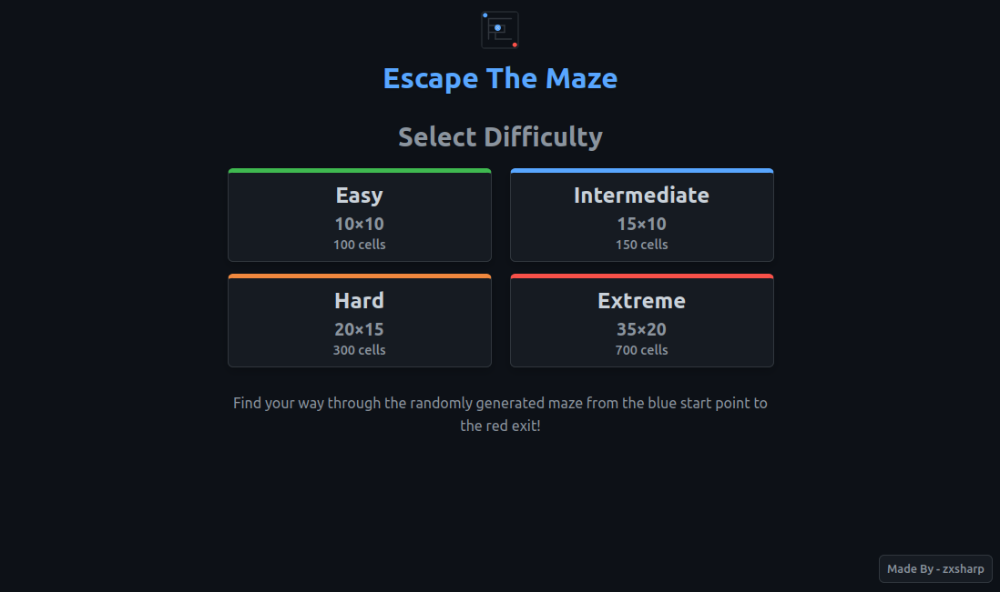
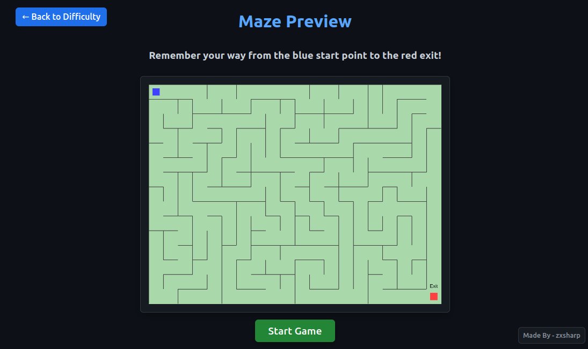
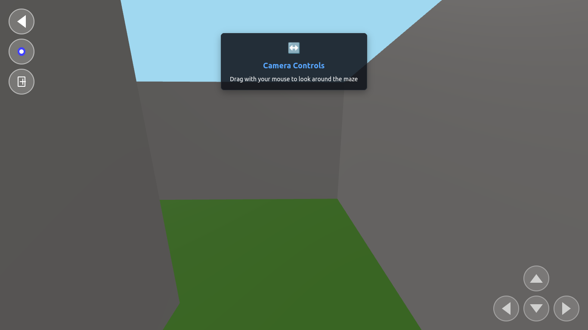
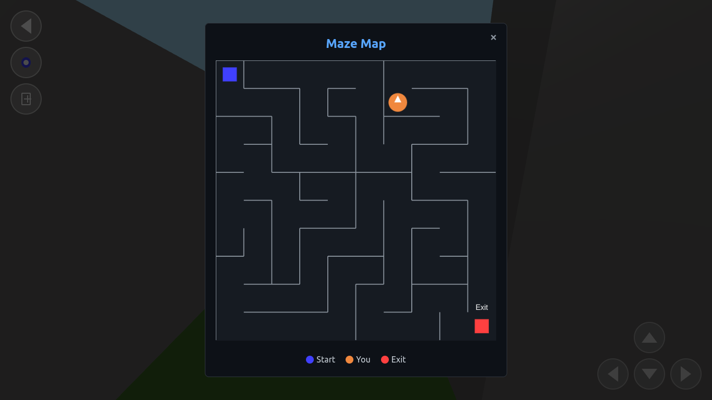
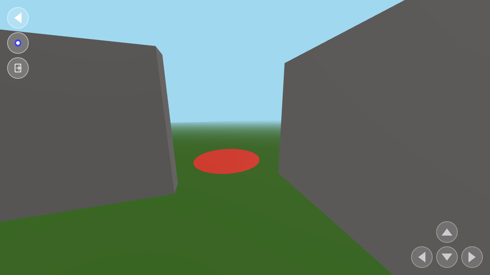

# Escape - Multiplayer 3D Web Maze Game

## [Play Now: escapeit.vercel.app](https://escapeit.vercel.app)

An interactive, first-person 3D maze game and multiplayer speed-running race built with **React**, **Three.js**, **WebSockets (Socket.io)**, and **JavaScript**.

---

## Overview

Escape is a 3D game where players navigate through a maze to find the exit. Before entering the maze, you are shown a 2D map to study your path, and then you must find your way through the winding corridors in a first-person 3D world to escape!

You can play solo to challenge your speed across multiple difficulties or create multiplayer rooms to race head-to-head with friends in real-time.

---

## Features

- **Solo Mode**: Procedurally generated solvable mazes across 4 difficulty tiers (*Easy*, *Intermediate*, *Hard*, *Extreme*) with a live stopwatch timer.
- **Multiplayer Race Mode**: Real-time room lobbies with custom room codes (e.g., `ESC-8A2F`).
- **Synchronized 2D Maze Preview**: In multiplayer, all players in the room preview the exact same maze map to study the route before the host initiates the synchronized countdown.
- **Deterministic Seeded Maze Generation**: Ensures a unique, guaranteed-solvable maze with a single path from start to exit for every race. ([Maze Generation Algorithm](https://en.wikipedia.org/wiki/Maze_generation_algorithm))
- **Live Opponent HUD**: Real-time player status tracking during multiplayer races showing who is still in the maze and finish times for players who have escaped.
- **First-Person 3D Navigation**: First-person camera with mouse/touch look, keyboard movement (WASD / arrows), and virtual on-screen controls for mobile.
- **Cheat Map & Mini-Map**: Optional top-down 2D minimap showing current position and orientation.

---

## How to Play

1. **Study the Map**: Check the 2D maze preview to memorize the path from the blue start point to the red exit.
2. **Navigate the Maze**: Use WASD, arrow keys, or mobile touch controls to explore the corridors.
3. **Reach the Exit**: Avoid dead ends, find the red exit zone, and escape in the fastest time possible!

---

## Screenshots

### Difficulty Levels


### Maze Preview


### Maze Entrance


### Cheat Map


### Maze Exit


---

## Controls

- **W / ↑**: Move Forward
- **S / ↓**: Move Backward
- **A / ←**: Strafe Left
- **D / →**: Strafe Right
- **Mouse Drag / Touch**: Look & Rotate Camera View

---

## Technologies Used

- **React 19 & Vite**: UI layout, state machine, room lobby, and HUD overlays
- **Three.js**: First-person 3D rendering, maze geometry, lighting, and camera physics
- **Socket.io**: Real-time multiplayer room matchmaking, seed synchronization, and race timings
- **Web Audio API**: Immersive directional movement, race countdown, and victory audio

---

## Running Locally

### 1. Install Dependencies
```bash
npm install
```

### 2. Start the Frontend (Vite)
```bash
npm run dev
```
Open `http://localhost:5173` in your browser.

### 3. Start the Multiplayer WebSocket Server
```bash
npm run server
```
Runs the lightweight Socket.io room server on port `3001`.

---

## Development

I made this game as a project to explore 3D rendering and real-time multiplayer on browsers.

## Feedback and Contributions

Feel free to provide feedback or contribute to the project by submitting issues or pull requests on our GitHub repository.
